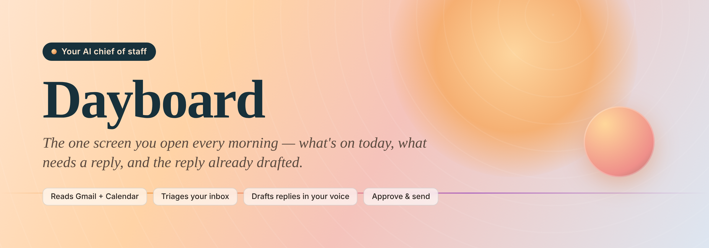
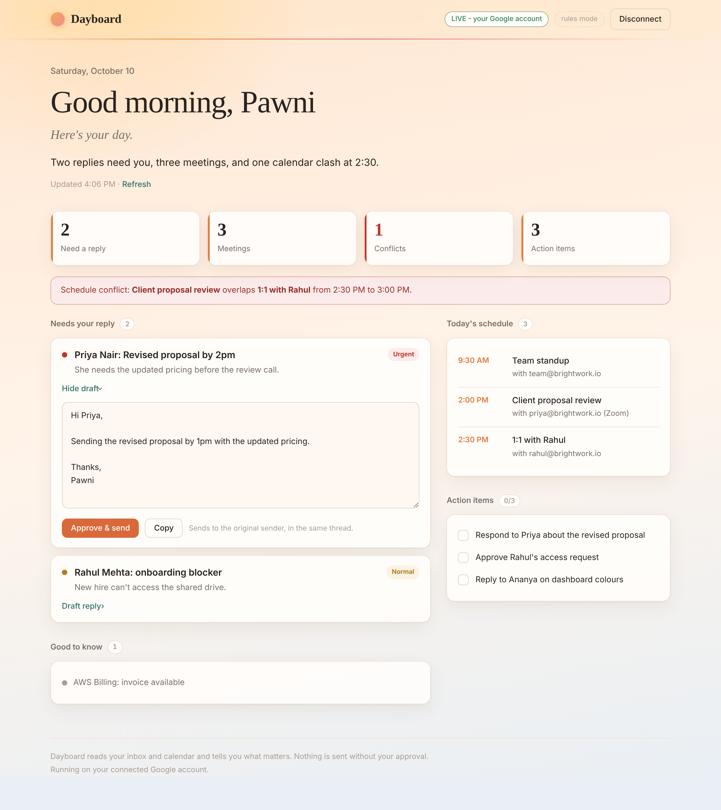
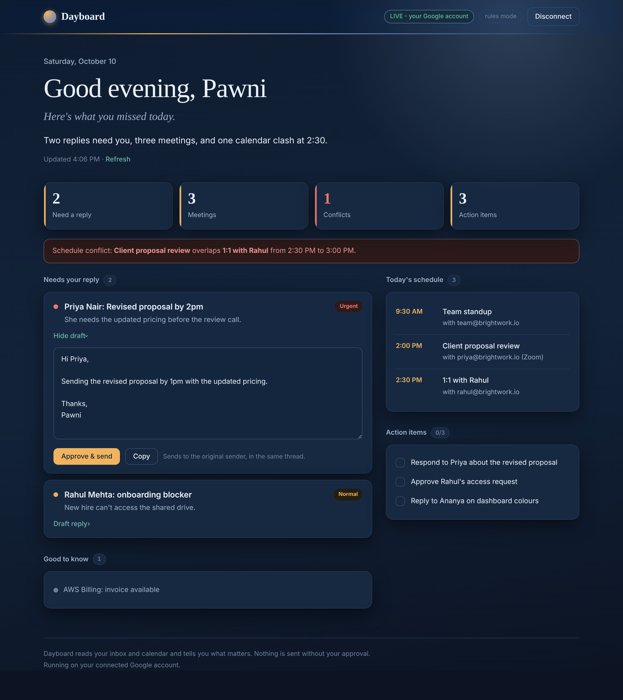
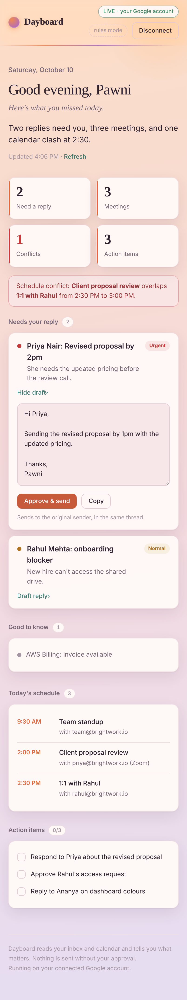
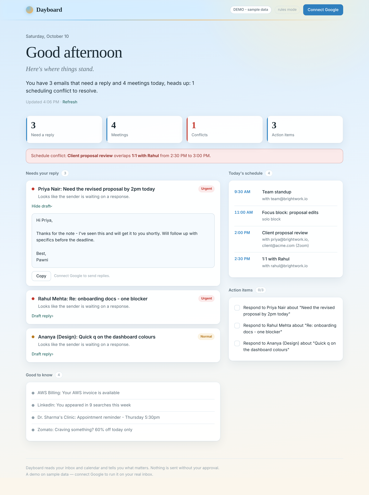

<p align="center">
  
</p>

<p align="center">
  
  
  
  
  
</p>

<h1 align="center">Dayboard</h1>

<p align="center"><b>An AI chief of staff you open with your coffee.</b><br>
It reads your inbox and calendar before you wake up and leaves one screen on your desk:<br>
here's your day, here's what matters, and here's the reply I'd send.</p>

---

## The idea

Most mornings start the same way: twenty minutes triaging an inbox to find the three emails that
actually need you. Dayboard does that pass for you. Open the page and you get a single, calm
screen, a greeting, a one-line summary of the day, the emails that genuinely need a reply (each
with a draft you can edit and send), your schedule with any conflicts flagged, and the day's
action items. Nothing is sent without your say-so.

It's a morning ritual, so it *looks* like one: the whole page is a sky that shifts with your
local time, sunrise through deep-blue night.

<p align="center">
  
</p>

<table>
  <tr>
    <td width="60%"></td>
    <td width="40%"></td>
  </tr>
  <tr>
    <td align="center"><em>Deep-blue night theme</em></td>
    <td align="center"><em>Fully responsive</em></td>
  </tr>
</table>

## What it does

- **Triages the inbox** — decides what genuinely needs a reply versus what's noise.
- **Drafts a reply for each one** — in your writing voice, ready to edit, approve, and send in-thread.
- **Flags calendar conflicts** — catches overlapping meetings before they catch you.
- **Pulls out action items** — an interactive checklist that remembers what you've ticked off.
- **Writes a one-line summary** of the whole day.
- **Greets you for the moment** — "Good morning / afternoon / evening, &lt;you&gt;", with a palette
  (dawn, day, dusk, night) that follows your local clock and updates live while the page is open.

## The design decision that makes it honest

The agent in `agent/core.py` is **identical** in demo mode and live mode. Only two things swap
underneath it, each behind a small interface:

| Axis | Demo | Live | Interface |
|---|---|---|---|
| **Data source** | sample inbox + calendar | real Gmail + Calendar (OAuth) | `DataProvider` |
| **Reasoning** | deterministic rules | Gemini | `agent/llm.py` |

So the public demo isn't a mockup, it's the real system running on sample data. Add a Google
account and it's the same code on your actual inbox; add a Gemini key and the same pipeline is
written by the model instead of the fallback rules. That's why you can try it with **zero setup**.

```
fetch  ->  triage  ->  draft replies  ->  detect conflicts  ->  action items  ->  summary  ->  Brief
         (LLM or rules at each step; falls back cleanly when no key is set)
```

## Run it (zero setup)

```bash
pip install -r requirements.txt
python run.py
# open http://127.0.0.1:8000
```

That works with no keys and no accounts, it uses the sample inbox (the **DEMO** badge).

<p align="center"></p>

### Turn on real AI reasoning

```bash
export GEMINI_API_KEY="your-key"   # free from aistudio.google.com
python run.py
```

The badge chip flips from **rules mode** to **AI reasoning**.

### Connect real Gmail + Calendar

Read-only to triage (`gmail.readonly`, `calendar.readonly`) plus `gmail.send` so an approved
reply can actually go out, nothing is sent unless you click **Approve & send**.

1. In the [Google Cloud console](https://console.cloud.google.com/): new project, enable the
   **Gmail API** and **Google Calendar API**.
2. Configure the OAuth consent screen (External; add yourself under **Test users**).
3. Create an **OAuth client ID**, type **Web application**, with redirect URI
   `http://127.0.0.1:8000/oauth2callback`.
4. Put the values in a local `.env` (auto-loaded, git-ignored, see `.env.example`):
   ```
   GOOGLE_CLIENT_ID=...apps.googleusercontent.com
   GOOGLE_CLIENT_SECRET=GOCSPX-...
   SESSION_SECRET=<python3 -c "import secrets;print(secrets.token_urlsafe(32))">
   DAYBOARD_USER_NAME=Pawni
   ```
5. `python run.py`, click **Connect Google**. The badge switches to **LIVE**.

### Make replies sound like you

Copy `voice.example.md` to `voice.md` and describe how you write (tone, greeting, sign-off, a
couple of examples). It's auto-detected and mirrored in every draft, and git-ignored so your
style never ends up in the repo.

## Deploy (Render)

Config lives in `render.yaml`. The public URL shows the demo to anyone; live mode works for
accounts added as Google test users.

1. Push to GitHub.
2. On Render: **New -> Blueprint**, pick the repo.
3. Set `GOOGLE_CLIENT_ID`, `GOOGLE_CLIENT_SECRET`, optional `GEMINI_API_KEY`, and
   `OAUTH_REDIRECT_URI=https://<your-app>.onrender.com/oauth2callback`.
4. Add that same callback URL to your Google OAuth client.

## Project structure

```
dayboard/
  models.py          shared data shapes (Email, CalendarEvent, Brief, ...)
  data/
    provider.py      the DataProvider interface
    seed.py          sample inbox + calendar (demo mode, no keys)
    google.py        real Gmail + Calendar (get, map, send)
    google_auth.py   OAuth 2.0 flow (PKCE), token in a signed session cookie
  agent/
    core.py          the agent: triage -> draft -> conflicts -> actions -> summary
    llm.py           provider-agnostic LLM client (Gemini)
    rules.py         deterministic fallback when no LLM is configured
    voice.py         optional writing-voice profile for drafts
  app.py             FastAPI app: dashboard, JSON API, OAuth + send routes
  web/templates/     the time-aware dashboard UI
```

## Tech

Python · FastAPI · Jinja2 · Google Gmail & Calendar APIs (OAuth 2.0 + PKCE) · Gemini
(provider-agnostic) · vanilla CSS/JS front end · deployed on Render.

## Author

**Pawni Tyagi**
